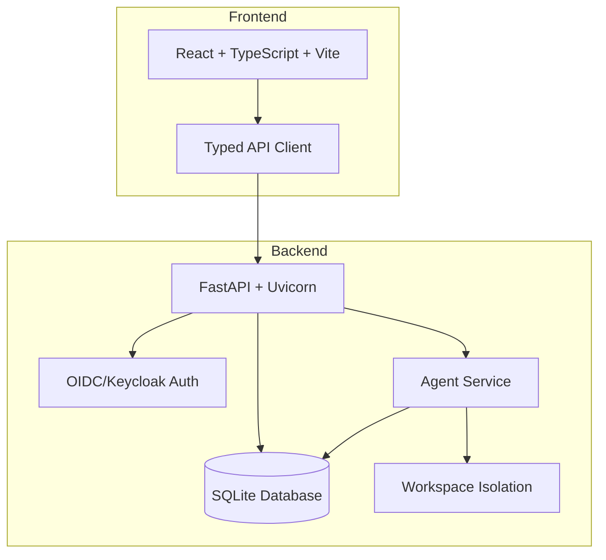

# Prism Forge

> Work in progress. This checkpoint may be incomplete or fail tests. See PLAN.md and STATUS.md before use.


**Prism Forge** — A smarter, self-hosted AI assistant — multi-user, multi-agent

By Alan Vo | alanvo@gmail.com

## Overview

Prism Forge is a self-hosted AI assistant platform designed for multi-user, multi-agent workflows. It provides strict agent workspace isolation, a typed API, and a modern React frontend for managing agents and their file operations.

### Key Features

- **Strict Agent Workspace Isolation**: Each agent is confined to its own workspace directory. Cross-agent file access is blocked with permission errors.
- **Multi-Agent Management**: Create, list, update, and delete agents with isolated workspaces.
- **File Operations**: Read, write, and list files within agent workspaces.
- **OIDC/Keycloak Authentication**: Secure authentication with demo mode for local development.
- **Health Monitoring**: Built-in health and readiness endpoints.
- **Docker Support**: Production-ready Dockerfiles and docker-compose for easy deployment.

## Architecture



## Quick Start

### Prerequisites

- Python 3.12+
- Node.js 24+
- Docker & Docker Compose (optional)

### Local Development

1. **Clone and setup backend:**
   ```bash
   cd backend
   python3 -m venv .venv
   source .venv/bin/activate
   pip install -r requirements.txt
   ```

2. **Run database migrations (auto on startup):**
   ```bash
   cp ../.env.example .env
   # Edit .env as needed
   ```

3. **Start backend:**
   ```bash
   PYTHONPATH=. python -m uvicorn backend.app.main:app --host 127.0.0.1 --port 8000 --reload
   ```

4. **Setup frontend:**
   ```bash
   cd frontend
   npm install
   npm run dev
   ```

5. **Access the application:**
   - Frontend: http://localhost:5173
   - Backend API: http://localhost:8000
   - API Docs: http://localhost:8000/docs

### Docker Deployment

```bash
docker-compose up -d
```

Services:
- Frontend: http://localhost:5173
- Backend: http://localhost:8000

### Configuration

Key environment variables (see `.env.example`):

| Variable | Description | Default |
|----------|-------------|---------|
| `DATABASE_URL` | SQLite database path | `sqlite+aiosqlite:///./data/prism.db` |
| `ENVIRONMENT` | `development` or `production` | `development` |
| `DEMO_MODE` | Enable demo auth (localhost only) | `true` |
| `OIDC_ENABLED` | Enable OIDC authentication | `false` |
| `OIDC_ISSUER_URL` | Keycloak issuer URL | - |
| `OIDC_CLIENT_ID` | Keycloak client ID | - |
| `OIDC_CLIENT_SECRET` | Keycloak client secret | - |
| `LLM_API_KEY` | LLM provider API key | - |
| `LLM_PROVIDER` | `openai-compatible`, `anthropic`, `gemini`, `ollama` | `openai-compatible` |

## API Reference

### Health

- `GET /api/health` — Health check with database status
- `GET /api/health/ready` — Readiness probe

### Agents

- `POST /api/agents` — Create agent
- `GET /api/agents` — List agents
- `GET /api/agents/{id}` — Get agent details
- `PATCH /api/agents/{id}` — Update agent
- `DELETE /api/agents/{id}` — Delete agent
- `GET /api/agents/{id}/files` — List files in workspace
- `GET /api/agents/{id}/files/read?path=...` — Read file
- `POST /api/agents/{id}/files/write` — Write file

## Workflows

1. **Create Agent** → Define name, workspace path, optional system prompt
2. **List Agents** → View all agents with status
3. **Manage Files** → Read/write files within agent's isolated workspace
4. **Update Agent** → Modify configuration, toggle active status

## Security

- **Demo Mode**: Only allowed on localhost (127.0.0.1, ::1)
- **Production Mode**: Requires OIDC configuration; refuses to start with demo mode enabled
- **Workspace Isolation**: Path traversal attempts blocked at service layer
- **No Hardcoded Secrets**: All credentials via environment variables

## License

MIT License — Copyright (c) 2024 Alan Vo <alanvo@gmail.com>